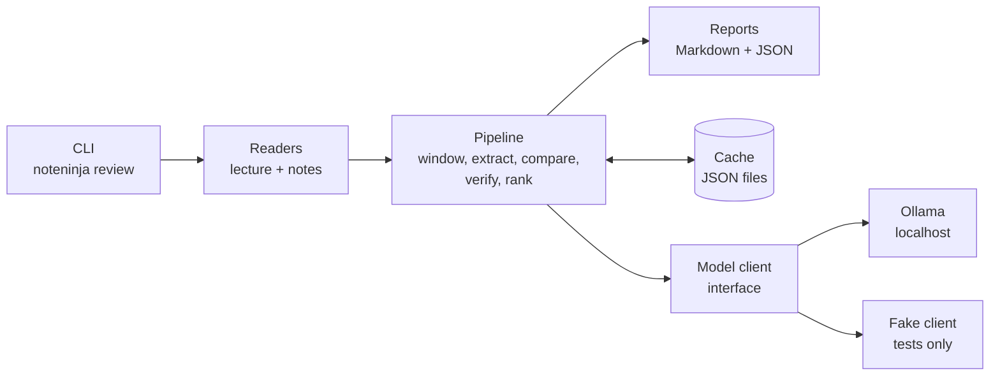
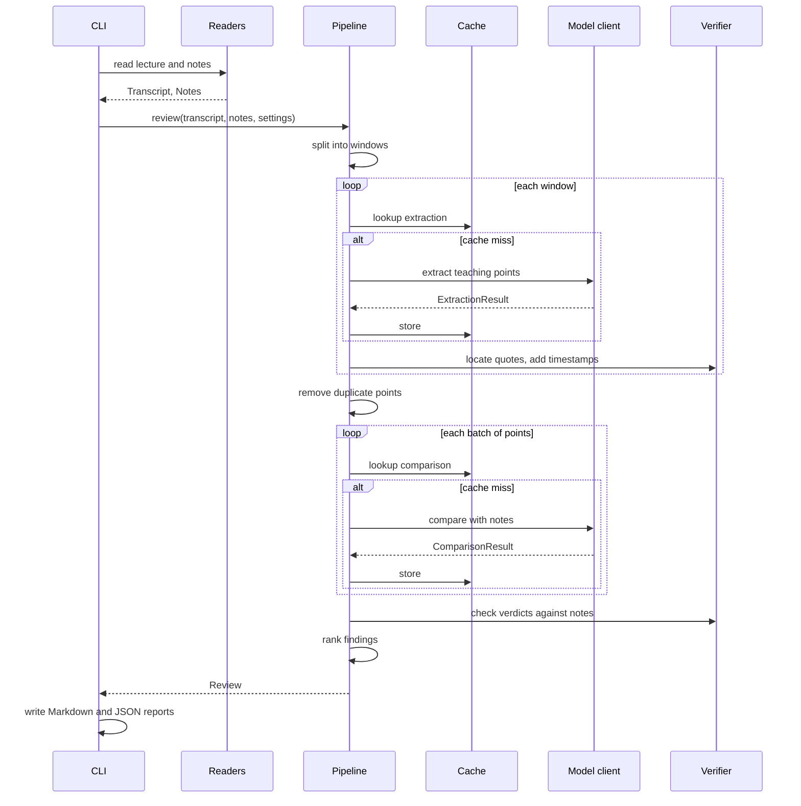

# NoteNinja architecture

**Status:** design, approved concept · **Date:** 2026-10-29 · **Covers:** Phase 1 in detail, later phases in outline

This document explains how NoteNinja is built. [CONCEPT.md](CONCEPT.md) explains what it is and why. [ROADMAP.md](ROADMAP.md) says when each part arrives. Where this document and the code disagree, the code wins and this document gets fixed.

## 1. Overview

NoteNinja is a local command-line tool (and later a local web app) written in Python. It reads a lecture transcript and a set of notes, runs a fixed four-step pipeline with a small open-weight model served by Ollama, and writes a review report.



Three ideas shape the design:

1. **The model proposes, code verifies.** The model only extracts and compares text. Everything checkable is checked by deterministic code: quotes, timestamps, line numbers and key terms.
2. **Small, narrow model calls.** Each call does one job on a bounded input, so a 4B model on a 6 GB GPU can handle it.
3. **Everything is a file.** Inputs, cache entries and reports are plain files. There's no server or database to run in Phase 1.

## 2. Repository layout

Target layout at the end of Phase 1. Later phases add modules in the places shown in [section 15](#15-later-phases).

```text
NoteNinja-AI/
├── src/noteninja/
│   ├── __init__.py          # package version
│   ├── __main__.py          # python -m noteninja
│   ├── cli.py               # Typer app: review, doctor, cache
│   ├── config.py            # Settings (pydantic-settings)
│   ├── domain.py            # core data types (Pydantic models)
│   ├── text.py              # normalisation with offset mapping
│   ├── sources/             # lecture readers: captions.py, transcript.py
│   ├── notes/               # note readers: markdown.py (handles .md and .txt)
│   ├── pipeline/            # windowing.py, extract.py, compare.py, verify.py, rank.py, review.py
│   ├── llm/                 # client.py (interface), ollama_client.py, fake.py, schemas.py
│   ├── prompts/             # extract.v1.md, compare.v1.md
│   ├── cache.py             # content-hash cache
│   └── report/              # markdown.py, json.py
├── tests/                   # unit, property, pipeline, CLI and adapter tests
│   └── fixtures/            # small captions, transcripts, notes, canned model outputs
├── evals/
│   ├── datasets/v0/         # synthetic lectures, note variants and labels
│   ├── results/             # one JSON file per benchmark run
│   └── RESULTS.md           # summary table, regenerated by the harness
├── examples/tcp-congestion/ # sample lecture, notes and generated review
├── docs/                    # CONCEPT.md, ARCHITECTURE.md, ROADMAP.md, plans/
├── .github/                 # workflows/ci.yml, dependabot.yml
├── pyproject.toml, uv.lock, .python-version
├── .env.example, .pre-commit-config.yaml, .gitattributes, .gitignore
└── README.md, LICENSE
```

The `src/` layout keeps tests honest: they import the installed package, not files that happen to sit next to them.

## 3. Domain model

All core types are immutable Pydantic models in `domain.py`. Times are seconds as floats; line numbers start at 1.

| Type | Key fields | Notes |
|---|---|---|
| `Segment` | `index`, `start`, `end`, `text` | One caption cue or transcript line |
| `Transcript` | `source`, `segments`, `sha256` | Validated: ordered, non-overlapping, non-empty |
| `Window` | `id`, `start`, `end`, `segment_range`, `text` | A slice of the transcript sent to the model |
| `NoteLine` | `number`, `text`, `heading_path` | `heading_path` is the chain of Markdown headings above the line |
| `Notes` | `source`, `lines`, `sha256` | Blank lines are kept so line numbers match the file |
| `TeachingPoint` | `id`, `window_id`, `summary`, `quote`, `key_terms`, `importance`, `start`, `end`, `quote_score` | `start` and `end` are filled in by the verifier, never by the model |
| `Verdict` | `point_id`, `label`, `note_lines`, `notes_quote`, `explanation`, `suggested_fix`, `fix_anchor_line` | `label` is `covered`, `partial`, `missed` or `conflict` |
| `Finding` | `point`, `verdict`, `placement`, `checks` | `placement` is `main`, `worth_a_check` or `dropped`; `checks` records each check's result |
| `Review` | `meta`, `findings`, `stats` | `meta` holds versions, model name and digest, settings, input hashes and timings |

The model never sees or returns most of these types. It returns smaller **output schemas** defined in `llm/schemas.py`:
- `ExtractionResult`: a list of points, each with `summary`, `quote`, `key_terms` and `importance`.
- `ComparisonResult`: a list of verdicts.

Keeping the model's schemas small makes them easier for a 4B model to follow, and keeps fields like timestamps out of the model's hands.

## 4. Pipeline

`pipeline/review.py` runs the steps in order. Each step is a plain function with typed inputs and outputs, so each can be tested on its own.



### 4.1 Reading inputs

- **Lecture readers** (`sources/`):
  - `.vtt` and `.srt` go through webvtt-py.
  - `.txt` transcripts with `[mm:ss]` or `[hh:mm:ss]` line prefixes go through a small parser.
  - Readers merge empty or duplicate cues, which auto-captions often produce, and reject files with no usable text.
- **Note readers** (`notes/`): `.md` and `.txt` become numbered `NoteLine`s. For Markdown, each line records the headings above it, so a report can say *nothing in "Flow control"*. Notion and Google Docs Markdown exports take the same path.
- A small registry maps file extensions to readers, so later formats (`.docx`, `.pdf`, images) only add a reader.

### 4.2 Windowing

Segments are grouped into windows of about `window_seconds` (default 240) that overlap by `overlap_seconds` (default 30).
- A window ends at a segment boundary, so sentences aren't cut in half.
- The next window starts at the first segment that begins within the overlap.
- A final window shorter than a third of the target is merged into the previous one.

Property tests check that every segment lands in at least one window and that windows are ordered.

### 4.3 Step 1: extract teaching points

For each window, the model gets the `extract` prompt and the window's plain text, with no timestamps. It returns an `ExtractionResult`. The prompt asks for:
- every fact, definition, rule, step or warning;
- an exact quote of 6 to 40 words copied from the text;
- two to five key terms;
- an importance level, based on cues such as definitions, formulas, repetition and phrases like "this will be on the exam".

Thinking is off for this step to keep it fast.

### 4.4 Locating quotes and removing duplicates

The verifier (`pipeline/verify.py`) locates every quote in its window. The match is done on normalised text: Unicode NFKC, case-folded, quotes and dashes unified, whitespace collapsed. `text.py` keeps a map from normalised offsets back to original offsets.

1. Try an exact substring match first.
2. Otherwise, use RapidFuzz `partial_ratio_alignment`, which returns a score and the matched span. Accept it if the score is at least `quote_match_threshold` (default 90).
3. Map the matched span back to segments, and take the first segment's start and the last segment's end as the point's timestamps.

Quotes shorter than 4 words are too generic to locate and are dropped, as are quotes with no match. Each drop is counted in `stats` by reason.

Overlapping windows produce duplicate points. Two points count as duplicates when:
- their matched spans overlap by more than half; or
- their summaries are very similar (RapidFuzz `token_set_ratio` ≥ 85) and they start within `overlap_seconds` of each other.

The point with higher importance, or else the longer quote, is kept.

### 4.5 Step 2: compare with notes

Points are sorted by time and sent in batches of up to 20 (or about 4K tokens). Each batch goes to the `compare` prompt together with the full notes, written as numbered lines (`L42: timeout -> cwnd halves`) with headings. The model returns a `ComparisonResult` with one verdict per point.

Phase 1 assumes a lecture's notes fit within the context budget, which is true for typical notes of a few thousand tokens. Longer notes fail with a clear message, and splitting them is a later improvement. Thinking stays off by default. The eval harness decides whether turning it on for this step is worth the time.

### 4.6 Step 3: verify verdicts

Each verdict goes through checks. Each result is recorded on the finding.

| Check | Rule | On failure |
|---|---|---|
| Point exists | `point_id` refers to a point in the batch | Verdict ignored |
| Lines exist | Every number in `note_lines` is a real line | Bad numbers removed |
| Evidence present | `covered`, `partial` and `conflict` need at least one valid line | Dropped (`no_evidence`) |
| Notes quote matches | `notes_quote` fuzzy-matches a cited line (threshold as above) | Dropped (`notes_quote_mismatch`) |
| Absence check | For `missed`, no key term appears in the notes (whole word, or RapidFuzz `partial_ratio` ≥ 90 for terms of 4+ characters) | Moved to `worth_a_check`, citing the lines where the terms appear |
| Fix sanity | `suggested_fix` is at most 200 characters, and `fix_anchor_line` exists | Fix kept without an anchor, or removed if too long |

Points the model skipped, which have no verdict, are listed in `stats.unjudged` and shown in the report as unchecked, never as "covered".

### 4.7 Step 4: rank and report

Each finding is scored as severity × importance:
- **Severity:** `conflict` 3, `missed` 2, `partial` 1, `covered` 0.
- **Importance:** high 3, medium 2, low 1.

Ties are broken by time. The main list holds the top `max_findings` (default 15) with a score of at least 2. Everything else goes into collapsed sections: "worth a check", "lower priority" and a count of covered points.

`report/` renders two files:
- **Markdown** for people: a header with the inputs, the model and its digest, and the date; then counts per label and dropped findings by reason; then the sections above.
- **JSON** for tools (`schema_version: 1`): the full `Review`. Phase 3's UI and the eval harness read this file.

## 5. Model client

### 5.1 Interface

```python
class LLMClient(Protocol):
    def generate(self, request: GenerationRequest, schema: type[T]) -> Generation[T]: ...
    def describe(self) -> ModelInfo: ...
```

| Type | Fields |
|---|---|
| `GenerationRequest` | `system`, `prompt`, `think` (bool), and `images` (Phase 4) |
| `Generation[T]` | `value` (a validated `T`), `prompt_tokens`, `output_tokens`, `duration_s` |
| `ModelInfo` | `name`, `digest`, `context_tokens` |

The pipeline only sees this interface. That keeps it testable without a model, and makes another runtime one new adapter.

### 5.2 Ollama adapter

`ollama_client.py` wraps the official `ollama` Python client:
- **Request:** a chat request with the schema's JSON Schema as `format`, temperature 0, the configured seed, an explicit context size, and thinking switched on or off per request.
- **Response:** checked with `schema.model_validate_json`.
- **Failures:** connection errors and timeouts are retried twice with backoff. An output that fails validation gets one retry, with the validation error added to the prompt. If that also fails, the window or batch is marked failed and the run continues; the report lists it.
- **`describe()`:** reads the model's digest from Ollama, so every report names the exact model build it used.

Adapter tests run against a mocked HTTP transport. They check the request shape and error mapping without a running server.

### 5.3 Fake client

`llm/fake.py` returns canned outputs, chosen by step and input hash, and can simulate errors and invalid output. Pipeline tests use it to cover:
- quotes that don't exist;
- line numbers out of range;
- false "missed" verdicts;
- skipped points;
- runtime failures.

### 5.4 Prompts

Prompts live in `src/noteninja/prompts/` as versioned text files, such as `extract.v1.md`, loaded with `importlib.resources`.
- The prompt id and version go into every cache key and every report.
- A prompt change is a new version. It's adopted only after the eval harness shows it's at least as good.

## 6. Caching

`cache.py` stores validated model outputs as JSON files under `cache_dir`, at `<stage>/<key[:2]>/<key>.json`.

- **Key:** the SHA-256 of a canonical JSON document holding the stage, prompt id and version, model name and digest, generation options (seed, context size, thinking) and the exact input. Any change produces a new key, so stale results are never reused.
- **What's cached:**
  - Extraction results depend only on the transcript, so they survive edits to the notes.
  - Comparison results depend on the points and the notes.
- **Writes** are atomic: a temporary file, then `os.replace`.
- **Unreadable entries** are ignored and overwritten.
- **Controls:** `--no-cache` skips the cache for one run, and `noteninja cache clear` empties it.

## 7. Configuration

`config.py` defines a `Settings` class (pydantic-settings) that reads `NOTENINJA_*` environment variables and an optional `.env` file. Command-line flags override both. `.env.example` lists every setting. There are no secrets to configure.

| Setting | Default | Meaning |
|---|---|---|
| `NOTENINJA_MODEL` | `qwen3.5:4b` | Ollama model tag (final default chosen by the Phase 1 benchmark) |
| `NOTENINJA_OLLAMA_HOST` | `http://localhost:11434` | Ollama server address |
| `NOTENINJA_CONTEXT_TOKENS` | `16384` | Context size requested per call |
| `NOTENINJA_SEED` | `7` | Seed for repeatable output |
| `NOTENINJA_TIMEOUT_SECONDS` | `300` | Per-call timeout |
| `NOTENINJA_WINDOW_SECONDS` | `240` | Target window length |
| `NOTENINJA_OVERLAP_SECONDS` | `30` | Window overlap |
| `NOTENINJA_QUOTE_MATCH_THRESHOLD` | `90` | Minimum fuzzy score for quotes and note citations |
| `NOTENINJA_MAX_FINDINGS` | `15` | Findings in the main list |
| `NOTENINJA_CACHE_DIR` | `~/.cache/noteninja` | Cache location |

## 8. Command-line interface

| Command | What it does |
|---|---|
| `noteninja review LECTURE NOTES` | Runs a review. Options: `--out` (Markdown path), `--json` (JSON path), `--model`, `--max-findings`, `--no-cache`. By default it writes `<notes-name>.review.md` and `.review.json` to the current folder and prints a summary |
| `noteninja doctor` | Checks the Python version, that Ollama is reachable, and that the model is pulled (with its digest). Prints the fix for anything missing, such as `ollama pull qwen3.5:4b` |
| `noteninja cache clear` | Empties the cache |
| `noteninja --version` | Prints the version |

Exit codes:
- `0` means success, including runs with warnings such as a failed window.
- `1` means bad input or usage.
- `2` means the model runtime is unavailable or failed completely.

## 9. Error handling

| Situation | Behaviour |
|---|---|
| Unreadable or empty input, unsupported extension | Clear message naming the file and supported formats; exit 1 |
| Ollama not running, or model not pulled | Message with the exact command to fix it; exit 2 |
| Notes too long for the context budget | Message with the size and the limit; exit 1 |
| One call fails after retries | That window or batch is marked failed; the run continues; the report and terminal show a warning |
| Every call fails | Exit 2 with the last error |
| Interrupted run (Ctrl+C) | Finished calls are already cached, so rerunning resumes quickly |

## 10. Testing

| Layer | What it covers | Tools | In CI |
|---|---|---|---|
| Unit | Readers, windowing, normalisation, verifier, ranking, cache, settings | pytest | Yes |
| Property | Windows cover every segment; any exact substring is located with the right timestamps; normalisation is idempotent | Hypothesis | Yes |
| Pipeline | Full reviews with the fake client, including every failure in [section 5.3](#53-fake-client) | pytest | Yes |
| Adapter | Ollama request shape, schema passing, retries and error mapping | pytest with a mocked HTTP transport | Yes |
| Reports | Markdown and JSON output against golden files | pytest | Yes |
| CLI | Commands, messages and exit codes | Typer's `CliRunner` | Yes |
| Integration | Real Ollama with a small model, marked `ollama` | `pytest -m ollama` | No, local only |
| Evals | Quality on labelled synthetic lectures | `evals/` harness | No, results committed |

The coverage target is at least 85% for `src/noteninja`, enforced in CI.

## 11. Evaluation harness

The harness measures what users care about: does NoteNinja find the gaps, and are its findings right?

**Dataset** (`evals/datasets/v0/<lecture-id>/`):
- `lecture.vtt`: a synthetic lecture written for this repo.
- `reference.md`: complete notes for it.
- `variants/<name>.md`: notes with known changes, such as removed points or altered facts.
- `variants/<name>.labels.toml`: one entry per change, with its kind (`missed` or `conflict`), time range and the lecture quote it concerns. Labels are TOML, read with the standard library's `tomllib`.

**Scoring:**
- A shown `missed` or `conflict` finding is a true positive when a label of the same kind overlaps its time range (within 15 seconds) or has a similar quote (RapidFuzz score ≥ 80).
- A finding that matches a label's position but has the wrong kind is reported separately as "found, wrong label".
- Unmatched findings are false positives. Unmatched labels are misses.

**Reported per model:**
- precision and recall per kind;
- the evidence pass rate (raw model findings that survive the checks);
- points extracted per lecture minute;
- processing time;
- token counts.

Each model runs with three different seeds, and results show the mean and spread.

**Choosing the default model:** among models with precision ≥ 0.85, pick the highest recall on omissions. If two are close, pick the faster one. If none reaches 0.85, pick the most precise and document the gap.

**Running it:**
- `uv run python -m evals run --model qwen3.5:4b` writes `evals/results/<date>-<model>.json`.
- `uv run python -m evals report` regenerates `evals/RESULTS.md`.

Evals need a GPU and Ollama, so they run locally. Their results are committed.

## 12. Tooling and CI

- **Project:** `pyproject.toml` (PEP 621) with `requires-python = ">=3.14"`, and `.python-version` set to 3.14. Later phases add optional extras (`audio`, `ui`, `vision`) so the core install stays small.
- **Dev group:** pytest, pytest-cov, Hypothesis, Ruff, mypy (strict, with the Pydantic plugin) and pre-commit.
- **CI:** `.github/workflows/ci.yml` runs on every push and pull request, on Ubuntu and Windows. The steps are:
  1. `uv sync --locked`
  2. `ruff check`
  3. `ruff format --check`
  4. `mypy`
  5. `pytest` with coverage

  Python 3.14 is required. Python 3.15 also runs for the core package while it has no 3.15-incompatible dependencies.
- **Dependabot** updates GitHub Actions and uv dependencies weekly.
- **pre-commit** runs Ruff and basic file hygiene hooks, matching CI.
- **`.gitattributes`** sets `* text=auto eol=lf`, so line endings don't flip between Windows and Linux.

## 13. Performance and resources

- **Budget:** each call stays within the context size. A 4-minute window is about 600 to 700 words, roughly 1K tokens, well under the limit.
- **Calls per 60-minute lecture:** about 16 extraction calls and 3 to 5 comparison calls. Ollama serves one request at a time on a 6 GB GPU, so the code stays synchronous; parallel requests would only compete for the same memory.
- **Model loading:** the model stays loaded for the whole run. From Phase 2, transcription runs before the model loads, so the two never share the GPU.
- **Progress:** a Rich progress bar shows windows and batches. The report records the time taken by each stage.

## 14. Security and privacy

- **Local by default.** The only network traffic goes to the configured Ollama host, which defaults to localhost. A host that isn't on this machine triggers a one-line notice. There's no telemetry.
- **Untrusted input.** A transcript or a set of notes could contain text that tries to steer the model (prompt injection). The model has no tools, its output is limited to a schema, and every claim is checked against the source text. The worst case is a dropped or odd finding, never an action.
- **Files.** Phase 1 only writes report files and cache entries. From Phase 3, applying a fix to the notes first writes a timestamped backup.
- **Dependencies.** A locked `uv.lock`, Dependabot and pinned Action versions.

## 15. Later phases

The interfaces above stay fixed; later phases add modules.

| Phase | New modules | Notes |
|---|---|---|
| 2 | `sources/media.py`, `notes/docx.py`, `notes/pdf.py` | faster-whisper with word timestamps turns audio or video into `Segment`s (optional `audio` extra), and the transcript is cached. `.docx` via python-docx and typed `.pdf` via pypdf become `NoteLine`s with headings |
| 3 | `ui/` | FastAPI app started by `noteninja ui`, with Jinja2 templates and htmx served locally. Media is served with HTTP range requests so the player can jump to any timestamp. An apply-fix service writes to Markdown notes with backups. Tested with Playwright |
| 4 | `notes/handwriting.py`, `sources/slides.py` | Page images go to the vision model, which returns a structured transcription with a confidence per line; you confirm unsure words before reviewing. Slides are read with pypdf, so findings can cite a slide number |
| 5 | `drills/` | Questions generated from findings, checked against the lecture quote, scheduled with FSRS in SQLite, and exportable to Anki |
| 6 | `course/`, `mcp_server.py` | A multi-lecture course index with a weak-topic view, plus an MCP server built on the official SDK. It runs over stdio and offers tools for reviews, weak topics and due drills |

## 16. Decision log

| # | Decision | Why | Alternatives considered |
|---|---|---|---|
| 1 | Fixed pipeline, not an agent | The steps are known in advance; predictable, cheaper, testable | Agent loop with tools |
| 2 | The model gives quotes; code gives timestamps | Timestamps can't be invented | Trusting timestamps from the model |
| 3 | Ollama with open-weight models only | Owner's decision (2026-10-29): free to run and private | Paid model APIs |
| 4 | No vector store in the MVP | Every part of the lecture must be checked | Retrieval (RAG) |
| 5 | Files and a JSON cache; SQLite only from Phase 5 | Simplest thing that works | A database from the start |
| 6 | Python 3.14 | onnxruntime has no 3.15 wheels yet | Python 3.15 |
| 7 | mypy in strict mode | Mature and widely used | pyright; ty (still before 1.0) |
| 8 | Synchronous model calls | One local GPU serves one request at a time | asyncio with parallel requests |
| 9 | TOML for eval labels | Readable and parsed by the standard library | YAML (extra dependency), JSON |
