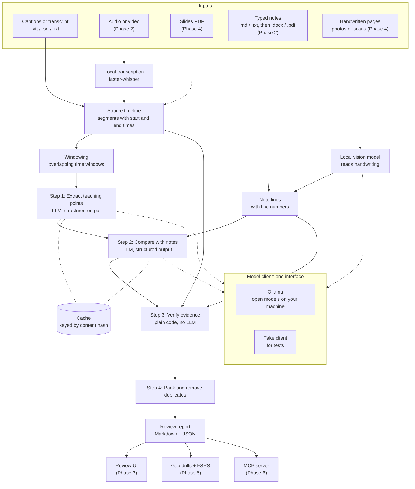
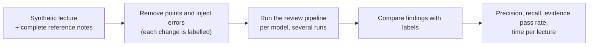

# NoteNinja: concept

**Status:** proposal, revised after first review · **Date:** 2026-10-29 · **Replaces:** the "chat with your lecture notes" idea in the old README

> **Your notes, reviewed.** NoteNinja compares the notes you took with the lecture you took them from. It shows what you missed and what you wrote down differently, and links every finding to the moment in the recording. Then it quizzes you on just those gaps. It runs on your own computer with free, open-source models.

You keep writing your own notes. NoteNinja is the second pass: a reviewer, not a ghostwriter.

---

## 1. Candidates considered

Research on AI note-taking tools (October 2026) produced three directions. Each one has a different user and problem.

| | Concept | For | Problem | State of the space | Verdict |
|---|---|---|---|---|---|
| **A** | **Second pass**: review your own notes against the lecture | Students and self-learners who take their own notes | Notes have gaps and errors that nobody catches until the exam | Many tools write notes *for* you. None found that reviews *your* notes against the source | **Recommended** |
| B | **Vault gardener**: code-review-style upkeep of a Markdown vault (duplicates, contradictions, stale notes) | Obsidian and PKM power users | Notes rot: duplicates, contradictions, outdated facts | Already covered piece by piece by Obsidian plugins (Contradiction Finder, Prior Art, Dualyze Notes, Burnish) | Not chosen: little room to stand out |
| C | **Decision ledger**: track decisions across meeting notes and flag reversals | Small teams, student project groups | "What did we decide, and why?" gets lost | Crowded (Fabric, Sentra, Decision Log, Decisions.ai), and hard to demo or evaluate without real team data | Not chosen |

**Why A:**
- It's the least-served need: no mainstream product does it.
- It answers the main criticism of AI study tools, that they do the thinking for you.
- Its quality can be measured with precision and recall on labelled data. That makes it testable and a strong portfolio project.
- It works well with small local models, because each step is a narrow, checkable task.

Also ruled out early:
- **AI flashcards from notes:** RemNote, Anki with FSRS, Knowt.
- **"Explain it back" tutors:** ReviseMate, Feynman AI, Teachback.
- **Sharing your notes with other AI apps over MCP:** Unabyss, Reflect's MCP server.

NoteNinja keeps the strongest idea from flashcards and tutors, retrieval practice, but uses it only on the gaps it finds.

## 2. The problem

In a live lecture you can't write everything down. While you write one point you miss the next. You mishear numbers, names and terms. A recording often exists, but checking your notes against it means rewatching 60 to 90 minutes. Almost nobody does that, so the gaps stay hidden until a problem set or exam exposes them.

Today's AI tools respond by taking the notes for you. Turbo AI, Knowt, Mindgrasp, StudyFetch and Coconote (bought by Quizlet in February 2026) turn a recording into notes, flashcards and quizzes. That's convenient, but it skips the work that makes taking notes useful for learning.

A CSCW 2025 study of AI-supported note-taking (Chen et al., 30 participants) compared three levels of AI help. Fully automated AI notes gave the **lowest** post-test scores, even though participants preferred them. Moderate help gave the highest.

So the need is this: **keep writing your own notes, but find out quickly and reliably what you missed and what you got wrong.**

## 3. Who it's for

**Primary:** university students who take their own notes in lectures that are recorded or have captions or slides. They might type in Markdown, Word, OneNote, Notion or Google Docs, or write on paper. It matters most in dense technical courses (CS, engineering, medicine), where a missed definition or a wrong number costs marks.

**Also:**
- Self-learners following recorded courses and talks.
- Professionals in recorded training or certification courses.

**Typical user:** a second-year CS student who types notes in Markdown (Obsidian or VS Code) during lectures. The university's learning platform posts recordings with auto-captions a day later. Before exams, the student skims their notes but never rewatches whole lectures. Their laptop has a mid-range gaming GPU and no budget for AI subscriptions.

**Not for:** people who want AI to write their notes, team meeting minutes, or live help during the lecture.

## 4. What's new

### 4.1 Compared with existing tools

| Tool (Oct 2026) | Writes notes for you | Chat or Q&A over sources | Links your notes to the recording | Reviews **your** notes against the source |
|---|---|---|---|---|
| NotebookLM | Study guides, overviews | Yes | No | No |
| Turbo AI, Knowt, Mindgrasp, StudyFetch, Coconote | Yes | Some | No | No |
| Otter.ai | Transcript, summary | Yes | No | No (you compare by hand) |
| Genio Notes, Notability | AI outline or summary | Some | Yes | No |
| Notion AI, Mem, Reflect, Obsidian Copilot | On request | Yes | No | No |
| **NoteNinja** | **No, by design** | **No** | **Through timestamps** | **Yes** |

This is based on public product pages and reviews (see [Sources](#sources)). I found no product that offers the last column.

Most of these tools also send your notes and recordings to a cloud service, often behind a subscription. NoteNinja runs entirely on your own machine with open-weight models, so nothing leaves the computer and it costs nothing to run.

### 4.2 Compared with a plain RAG chatbot

A RAG chatbot answers questions you already know to ask. It fetches the few chunks that best match your question and writes an answer. NoteNinja answers a question you can't ask: *what did I miss?* That needs a different design.

| | Plain RAG chatbot | NoteNinja |
|---|---|---|
| Starts from | Your question | Your notes plus the source, no question needed |
| Coverage | The top few matching chunks | Every part of the source is checked |
| Output | Free-text answer | Typed findings (`missed`, `partial`, `conflict`) with timestamp, quote and note line |
| Trust | Citations at best | Code checks every quote and timestamp before showing it |
| Quality | Hard to measure | Precision and recall on labelled test sets |
| Storage | Vector database | None needed for the MVP: each call sees a window of the lecture plus the notes |

## 5. How it works

1. **You give it two files:** the lecture and your notes.
   - Lecture: captions or a transcript in the MVP; audio, video and slides later.
   - Notes: Markdown or text in the MVP; Word, Google Docs, Notion and OneNote exports, and photos of handwritten pages, later.
2. **It maps the lecture.** The transcript is split into short, overlapping time windows (about 4 minutes each, overlapping by 30 seconds; both adjustable). A model lists the *teaching points* in each window: every fact, definition, rule, step or warning the lecturer states. Each point comes with a short exact quote, its key terms and an importance level (high, medium or low).
3. **It checks your notes.** A second step compares every teaching point with your notes, gives it one of four labels and points to the note lines involved:

   | Label | Meaning |
   |---|---|
   | `covered` | Your notes capture the point |
   | `partial` | Your notes mention it but miss a key detail |
   | `missed` | Your notes don't have it |
   | `conflict` | Your notes say something different from the lecture |
4. **It verifies before it shows anything.** Code, not the model, checks that:
   - every quote really appears in the transcript, and takes the timestamp from where the quote was found (it never trusts a timestamp the model wrote);
   - every cited note line exists and says what the model claims;
   - a "missed" point's key terms really don't appear in your notes. If they do, the finding is moved to "worth a check".

   Findings that fail these checks are dropped and counted.
5. **You get a review.** It's a short ranked list, conflicts first and then important missed points. Each finding shows what was said, when it was said, what your notes say, and a suggested one-line fix. In the MVP you copy fixes in yourself; from Phase 3 the review UI can apply the ones you accept. From Phase 5, a short *gap drill* follows each review, with questions on only what you missed.

Extra material in your notes (from a textbook, say) is fine. It's only flagged if it contradicts the lecture.

Example output, for a made-up lecture on TCP congestion control:

```text
CONFLICT · high importance · 23:41-23:58
  Lecture:    "on a timeout, cwnd drops back to one segment and we go into slow start again"
  Your notes: line 42: "timeout -> cwnd halves"
  Suggested:  line 42: "timeout -> cwnd = 1 MSS, back to slow start (halving is for 3 dup ACKs)"

MISSED · high importance · 31:05-31:40
  Lecture:    "the receiver window caps all of this, the sender can never exceed rwnd"
  Your notes: nothing in "Flow control" (lines 50-58)
  Suggested:  after line 55: "sender rate <= min(cwnd, rwnd)"
```

Teaching points are cached per lecture. After you fix your notes, a new review only reruns the cheaper comparison step. Every step runs on your machine through Ollama.

## 6. Features: MVP vs later

| Phase | Scope | Demo |
|---|---|---|
| **1: MVP** | <ul><li>CLI `noteninja review lecture.vtt notes.md`</li><li>Lecture: `.vtt` or `.srt` captions, or a timestamped transcript</li><li>Notes: Markdown or text, which also covers Notion's and Google Docs' Markdown exports</li><li>Teaching-point extraction, comparison with notes, evidence checks</li><li>Cache of model results keyed by content hash</li><li>Ranked Markdown and JSON report</li><li>Ollama and fake (test) model clients</li><li>Evaluation harness v0 on synthetic lectures</li><li>Benchmark of four open models that fit a 6 GB GPU, which picks the default</li></ul> | One command on the bundled sample lecture and notes gives a review with verified findings, with the network unplugged |
| 2: Audio, video and typed formats | <ul><li>Local transcription with word timestamps (faster-whisper on the GPU if there is one, CPU otherwise)</li><li>Transcript cache and course vocabulary hints</li><li>Word `.docx` notes, which covers Word, Google Docs and OneNote exports</li><li>Typed PDF notes, for OneNote and other apps that export to PDF</li></ul> | Review Word or OneNote notes against an `.mp3` or `.mp4` |
| 3: Review UI | Local web app with findings next to a player that jumps to each timestamp; accept or dismiss suggestions; accepted fixes are written into the notes file (Markdown first), with a backup | Click a finding, hear the moment, accept the fix |
| 4: Handwriting and slides | <ul><li>Photos or scans of handwritten pages (`.jpg`, `.png`, `.heic`, scanned PDF, or OneNote ink exported to PDF), read by a local vision model</li><li>Unsure words flagged for you to confirm before the review runs</li><li>Slides (PDF) as a second source</li></ul> | Review handwritten notes against the lecture and slides |
| 5: Gap drills | Questions built only from findings; spaced-repetition scheduling (FSRS) across all lectures of a course; Anki export | A daily drill on the points you keep missing |
| 6: Course view and integrations | Course dashboard (weak topics across lectures); an MCP server so desktop assistants and IDEs can ask "what are my weak topics this week?"; Obsidian-friendly output | Ask an MCP client about your weak topics |

Each phase ships with tests, linting, CI and a working demo, and ends with a stop for review. After approval, `docs/ROADMAP.md` will list deliverables and done criteria for each phase.

**Out of scope:** paid model APIs, live help during the lecture, recording lectures, shared team workspaces, a hosted multi-user service, and mobile apps.

## 7. AI tech it builds on, and why

| Capability | How NoteNinja uses it | Why it's possible now |
|---|---|---|
| Small open-weight models | The whole pipeline runs locally, with `qwen3.5:4b` (3.3 to 4 GB, Apache 2.0) as the default | 4B-parameter models now fit a 6 GB GPU with room left for context, and score well on structured extraction |
| Structured outputs | Every model call returns a schema-checked object (Pydantic models), so there's no parsing of free text | Ollama limits the model's output to a JSON schema passed in `format`, so even small models return valid JSON |
| Long context | Your whole notes plus a transcript window fit in one call | Qwen3.5 accepts 256K tokens. NoteNinja keeps calls to about 8K to 16K so they stay fast on a laptop |
| Switchable thinking | Off for extraction (speed), and on for the comparison step only if evals show it helps | Qwen3.5 can turn its thinking mode on or off per call |
| Local speech recognition with word timestamps | Precise anchors for every finding; audio never leaves your machine (Phase 2) | faster-whisper (CTranslate2) runs on a 6 GB laptop GPU or on the CPU |
| Vision in small models | Reading handwritten notes and slides (Phase 4) | `qwen3.5:4b` and `ministral-3:3b` accept images; `gemma4:e2b` is stronger at OCR |
| Spaced repetition (FSRS) | Scheduling gap drills (Phase 5) | FSRS is the standard scheduler in Anki and RemNote, and has a maintained Python library |
| MCP | Sharing reviews and weak topics with other assistants and tools (Phase 6) | The current spec (2026-07-28) has no session handshake, so servers are simpler to run; the official Python SDK is at 2.x |

**Deliberately not used:**
- **Paid model APIs.** By design, NoteNinja is free to run and private. The model client interface leaves room for other open-model runtimes (such as llama.cpp or LM Studio servers) later.
- **Vector database or RAG retrieval in the MVP.** The task needs every part of the lecture checked, not the top few matches. Embeddings may come back later for search across a course.
- **An autonomous agent.** The steps are known in advance, so a fixed pipeline is faster, more predictable and easier to test.
- **Fine-tuning, for now.** If evals show the small model is the bottleneck, a later phase could fine-tune a small open model on synthetic review data with QLoRA. On a 6 GB GPU that's feasible for models up to about 3B parameters.

## 8. Architecture



How quality is measured (the eval harness):



Key design decisions:

- **The model writes quotes; code writes timestamps.** A timestamp always comes from where the quote matched in the transcript, so it can't be made up.
- **Small jobs for small models.** Each call does one narrow task (one lecture window, or one batch of points against the notes) and stays within about 8K to 16K tokens. That suits 4B models and keeps them fast.
- **Two cached stages.** Teaching points are cached by a hash of the transcript, and comparison results by a hash of the points and notes. Reviewing edited notes again is quick.
- **One model client interface.** The pipeline depends on an `LLMClient` interface with an Ollama implementation and a fake one for tests. It never imports the Ollama SDK directly, and tests never touch the network. Supporting another open-model runtime later means adding one adapter.
- **Repeatable runs.** Every call uses temperature 0 and a fixed seed, and each report records the model name and digest.
- **One GPU job at a time.** Transcription and the language model run one after the other, so they never compete for the GPU's memory.
- **Precision before recall in what's shown.** A wrong "you missed this" costs trust. Uncertain findings go into a collapsed "worth a check" section instead of the main list.
- **Plain files.** Inputs and outputs are Markdown, JSON and caption files. There's no database until spaced repetition needs one (Phase 5, SQLite).
- **Config from the environment.** `pydantic-settings` reads `NOTENINJA_*` variables and an optional `.env` file, such as the model name and Ollama address. No API keys are needed. `.env.example` documents every setting.
- **Privacy.** Everything runs locally, and nothing leaves your machine unless you point NoteNinja at an Ollama server on another computer you control. There's no telemetry.

**Hardware target:** a Windows laptop with an NVIDIA RTX 4050 (6 GB of VRAM) and 16 GB of RAM. It works on the CPU alone, just more slowly. Machines with 8 GB or more of VRAM can use a larger model such as `qwen3.5:9b`.

## 9. Tech stack

Versions were checked on 2026-10-29 against PyPI, the official docs, model cards and GitHub releases. Exact versions will be locked in `uv.lock`.

| Area | Choice | Version | Why |
|---|---|---|---|
| Language | Python | 3.14 (3.14.10) | Strong ML and audio ecosystem. 3.14 gets bug fixes until 2030. 3.15 is out, but onnxruntime (which faster-whisper needs) has no 3.15 wheels yet |
| Environment and packaging | uv | 0.13.6 | One tool for the Python install, virtual environment and lockfile; `uv sync` gives the same setup everywhere |
| Lint and format | Ruff | 0.17.3 | Fast; replaces flake8, isort and black |
| Type checking | mypy (strict) | 2.4.1 | Mature. Astral's `ty` (0.0.94) is still before 1.0 |
| Tests | pytest, pytest-cov, Hypothesis | 9.2.0, 7.1.0, 6.170.13 | Hypothesis for property tests of the parsers and the evidence checker |
| Data models | Pydantic | 2.14.1 | The same schemas serve model outputs, reports and tests |
| Config | pydantic-settings | 2.16.2 | Typed settings from env and `.env` |
| CLI | Typer, Rich | 0.27.3, 15.0.0 | Typed commands and readable terminal output |
| Model runtime | Ollama server and `ollama` Python client | 0.40.13, 0.6.3 | Runs open models locally, with JSON-schema outputs |
| Captions | webvtt-py | 0.6.0 | Reads WebVTT, SRT and SBV |
| Quote matching | RapidFuzz | 3.14.6 | Fast fuzzy matching for the evidence checks |
| Transcription (Phase 2) | faster-whisper on CTranslate2 | 1.2.1 on 4.8.4 | Word timestamps on CUDA or CPU, MIT license. Last release Oct 2025, still active (commits in Oct 2026) |
| Word notes (Phase 2) | python-docx | 1.2.0 | Reads `.docx` paragraphs with heading and list styles |
| PDF notes and slides (Phases 2 and 4) | pypdf | 6.21.4 | BSD license (avoids the AGPL-licensed PyMuPDF) |
| Review UI (Phase 3) | FastAPI, Uvicorn, Jinja2, htmx | 0.162.0, 0.54.0, 3.1.6, 2.0.11 | Small server-rendered app with almost no hand-written JavaScript |
| Images (Phase 4) | Pillow, pillow-heif | 13.0.0, 1.8.1 | Resizing photos before the vision model; reading iPhone HEIC photos |
| Spaced repetition (Phase 5) | fsrs (py-fsrs) | 6.3.2 | Reference FSRS implementation |
| MCP server (Phase 6) | `mcp` (official Python SDK) | 2.3.0 | Supports spec 2026-07-28 |
| CI | GitHub Actions with `actions/checkout`, `astral-sh/setup-uv` | v7.0.1, v10.3.3 | Ubuntu and Windows matrix |
| Git hooks | pre-commit with ruff-pre-commit | 4.7.0, v0.17.3 | The same checks run locally and in CI |

**Model shortlist.** Ollama downloads models at runtime; they aren't stored in the repo. Phase 1 benchmarks the first four on the eval set and picks the default from measured precision, recall and speed.

| Model (Ollama tag) | Download | License | Role |
|---|---|---|---|
| `qwen3.5:4b` | 3.3 to 4.0 GB | Apache 2.0 | Default. Text and images, switchable thinking, best reported extraction scores at this size |
| `ministral-3:3b` | 3.0 GB | Apache 2.0 | Benchmark candidate. Text and images |
| `phi4-mini` (3.8B) | 2.5 GB | MIT | Benchmark candidate. Text only; small and fast |
| `granite4:3b` | 2.1 GB | Apache 2.0 | Benchmark candidate. Text only; smallest |
| `gemma4:e2b` | 4.6 GB and up | Apache 2.0 | Handwriting candidate for Phase 4 (stronger OCR); a tight fit on 6 GB |
| `qwen3.5:9b` | 6.6 to 7.6 GB | Apache 2.0 | For GPUs with 8 GB or more; too big for 6 GB without spilling into system RAM |

All code dependencies use MIT, BSD, Apache-2.0 or similar permissive licenses (Pillow uses MIT-CMU), which fit the project's MIT license.

## 10. Risks and mitigations

| Risk | Impact | Mitigation |
|---|---|---|
| Small local models make more mistakes than large cloud models | False or missed findings | One narrow task per call; evidence checks; key-term check; "worth a check" section; four models benchmarked and picked by measured precision; larger models on bigger GPUs; fine-tuning as a later option |
| False "you missed this" findings | Users stop trusting it | Precision-first ranking and the checks above; precision tracked in evals |
| Shorthand and paraphrase in notes ("cwnd ½ on loss") | Points that are covered get reported as missed | A `partial` label; the model sees the whole notes; dismissed findings are kept as future test cases |
| Slow processing on a laptop | Long waits per lecture | Thinking off for extraction; small prompts; caching; a progress bar; time per lecture measured in evals |
| GPU memory runs out (6 GB) | Crashes or a slow fallback to the CPU | One GPU job at a time; models chosen to fit with their context; context size set explicitly; a clear error that suggests a smaller model |
| Transcription errors on technical terms or accents (Phase 2) | Wrong quotes, so wrong findings | Prefer official captions when they exist; vocabulary hints; flag low-confidence words |
| CUDA setup on Windows is fiddly (Phase 2) | GPU transcription fails | CPU (int8) fallback always works; setup documented and tested in CI on Windows |
| Messy exports (Notion callouts exported as HTML, OneNote sections exported as one long document) | Broken line structure | One reader per format, tested on real export samples; plain-text fallback |
| Handwriting misread (Phase 4) | Wrong note lines, so wrong findings | Unsure words flagged; you confirm the transcription before the review runs |
| Recording consent and copyright | Legal or ethical trouble for users | Only process sources you have the right to use; local processing; no upload or sharing features; stated in the README. Test data is synthetic, written for this repo |
| Outputs vary between runs | Flaky tests, noisy evals | Temperature 0 and a fixed seed; tests use the fake client; evals still run several times and report the spread |
| Scope creep from many input types | The MVP slips | Text-only MVP; formats added phase by phase; a review stop after every phase |
| Fast-moving dependencies and model tags | Breakage | `uv.lock`, model tags and digests recorded, Dependabot, CI on every PR |
| The learning benefit of this exact design is unproven | Overclaiming | Claim only what's measured (detection quality, time saved); cite related research honestly |

## 11. Decisions from the first review

Decided on 2026-10-29:

| Question | Decision |
|---|---|
| Which models? | Open-weight models through Ollama only. No paid model APIs |
| Default on first run | Local Ollama, the only model runtime. Default model `qwen3.5:4b`, to be confirmed by the Phase 1 benchmark |
| Note formats | All of these, in this order: <ul><li>Phase 1: Markdown and text, which also covers Notion and Google Docs Markdown exports</li><li>Phase 2: Word `.docx` and typed PDF, which covers Word, Google Docs and OneNote exports</li><li>Phase 4: handwritten photos and scans</li></ul> |
| Phase order | Review UI (Phase 3) before handwriting and slides (Phase 4) |
| Test data | Synthetic lectures only, written for this repo with labelled gaps |
| Name and license | `NoteNinja-AI` repo, `noteninja` CLI and package, MIT license |

No open questions remain. The Phase 1 benchmark will settle the default model.

## 12. How success is measured

| Area | Metric | First target | How it's measured |
|---|---|---|---|
| Finding gaps | Recall of seeded omissions of important points | ≥ 0.75 | Eval harness, default model |
| Trust | Precision of shown `missed` and `conflict` findings | ≥ 0.85 | Eval harness, default model |
| Catching errors | Recall of seeded contradictions | ≥ 0.60 | Eval harness, default model |
| Grounding | Share of raw model findings that pass the evidence checks | ≥ 0.90 (shown findings pass 100%, since failures are dropped) | Checker counters in every run |
| Processing time | Time to review a 60-minute lecture from captions on the RTX 4050 laptop | ≤ 15 minutes | Timed in eval runs |
| Time for the user | Time to read a review and fix the notes for a 60-minute lecture | Under 10 minutes, compared with 60+ minutes of rewatching | Timed trial on sample lectures |
| Cost and privacy | Money spent and data sent off the machine | $0 and nothing | No paid services in the stack; offline check in every phase demo |
| Engineering | CI passing on Ubuntu and Windows, mypy strict clean, at least 85% test coverage of the core package, one-command demo | Every phase | CI |

These targets are first guesses. Phase 1 sets the baseline, and the roadmap may adjust the targets based on what it shows.

## Sources

Research done in October 2026. Many product details come from reviews and secondary sources, so specifics may have changed.

**Learning research**
- Chen et al., *More AI Assistance Reduces Cognitive Engagement: Examining the AI Assistance Dilemma in AI-Supported Note-Taking*, CSCW 2025: <https://arxiv.org/abs/2509.03392>

**Note-taking and study tools**
- AI lecture note tools for students: <https://www.meetjamie.ai/blog/best-ai-note-takers-for-students>
- Turbo AI (formerly TurboLearn): <https://scribbl.co/post/turbo-ai-notetaker-alternative>
- Coconote and the Quizlet acquisition: <https://makerstack.co/reviews/coconote-review/>
- Genio Notes: <https://learningtech.virginia.edu/tools/genio>, <https://dres.illinois.edu/accommodations/ams/assitive-technology/note-taking-software/>
- Notability, GoodNotes, OneNote Copilot: <https://www.youngju.dev/blog/culture/2026-05-16-ai-digital-ink-handwritten-notes-2026-apple-pencil-math-notes-goodnotes-6-notability-concepts-onenote-copilot-nebo-supernote-remarkable-deep-dive.en>
- NotebookLM 2026 updates: <https://nokiapoweruser.com/google-notebooklm-upgrade-agentic-features-ai-ultra/>
- Notion AI agents: <https://eesel.ai/blog/notion-ai-review>
- Mem: <https://blog.saner.ai/mem-ai-reviews>
- Reflect: <https://yespress.io/products/reflect.md>
- Obsidian AI plugins: <https://unabyss.com/blog/best-ai-plugins-for-obsidian>
- Vault maintenance plugins:
  - <https://community.obsidian.md/plugins/contradiction-finder>
  - <https://community.obsidian.md/plugins/prior-art>
  - <https://forum.obsidian.md/t/dualyze-notes-find-similar-notes-and-create-safe-merge-drafts/115158>
  - <https://community.obsidian.md/plugins/burnish>
- Decision logs:
  - <https://fabric.so/solutions/decision-log>
  - <https://www.sentra.app/articles/ai-meeting-memory>
  - <https://www.upmeet.ai/en/blog/meeting-ai-is-starting-to-track-decision-drift>
- Flashcards and explain-back apps: <https://www.remnote.com/feature/spaced-repetition>, <https://teachback-web.pages.dev/>

**Note export formats**
- Notion export (Markdown & CSV, HTML, PDF): <https://www.notion.com/help/export-your-content>
- Google Docs Markdown download: <https://support.google.com/docs/answer/12014036>
- OneNote export to Word or PDF: <https://learn.microsoft.com/en-us/answers/questions/5598575/how-can-i-export-my-notebooks-from-onenote-to-a-wo>, <https://support.microsoft.com/en-us/office/export-notes-as-a-pdf-file-in-onenote-for-mac-a21723fb-6ac9-4c01-9462-e9edda15ab2d>

**Models**
- Ollama library pages:
  - <https://ollama.com/library/qwen3.5>
  - <https://ollama.com/library/ministral-3>
  - <https://ollama.com/library/phi4-mini>
  - <https://ollama.com/library/granite4>
  - <https://ollama.com/library/gemma4>
- Model cards and licenses:
  - <https://huggingface.co/Qwen/Qwen3.5-4B>
  - <https://huggingface.co/Qwen/Qwen3.5-9B>
  - <https://huggingface.co/microsoft/Phi-4-mini-instruct>
  - <https://huggingface.co/google/gemma-4-E2B-it>
- Small models for 6 GB of VRAM: <https://localaimaster.com/vram/best-ollama-models-6gb-vram>
- Extraction scores of Qwen3.5 4B vs Gemma 4 E4B (IDP Leaderboard, secondary report): <https://reddit.sentinel-team.org/posts/1sfr6qo/snapshots/2026-04-09T16%3A11%3A00.655487Z>
- Ollama structured outputs: <https://docs.ollama.com/capabilities/structured-outputs>

**Other technology**
- Local speech-to-text comparison: <https://openwhispr.com/blog/parakeet-vs-whisper-vs-nemotron>
- faster-whisper: <https://github.com/SYSTRAN/faster-whisper>
- MCP versioning: <https://modelcontextprotocol.io/docs/learn/versioning>
- MCP Python SDK 2.3.0: <https://github.com/modelcontextprotocol/python-sdk/releases/tag/v2.3.0>
- Python release status: <https://www.python.org/downloads/>
- uv installation: <https://docs.astral.sh/uv/getting-started/installation/>
- Package versions: PyPI JSON API (`https://pypi.org/pypi/<package>/json`), checked 2026-10-29
